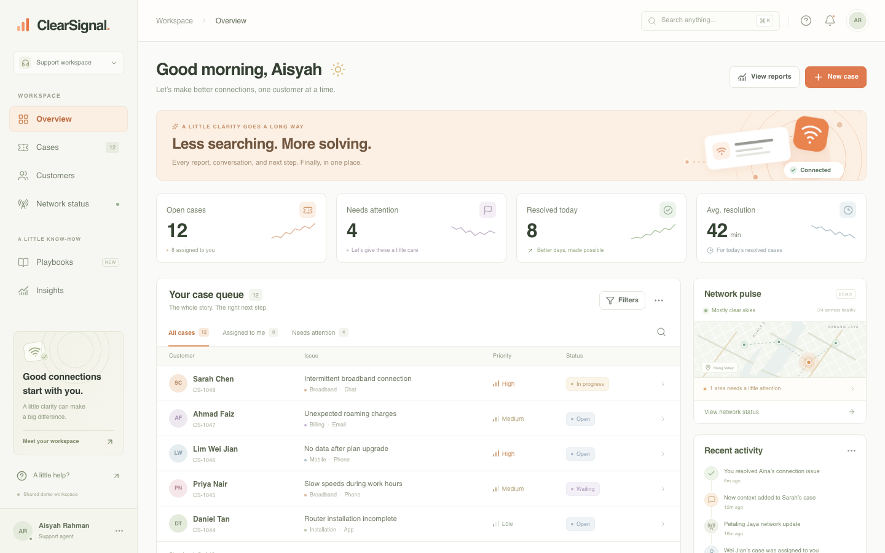
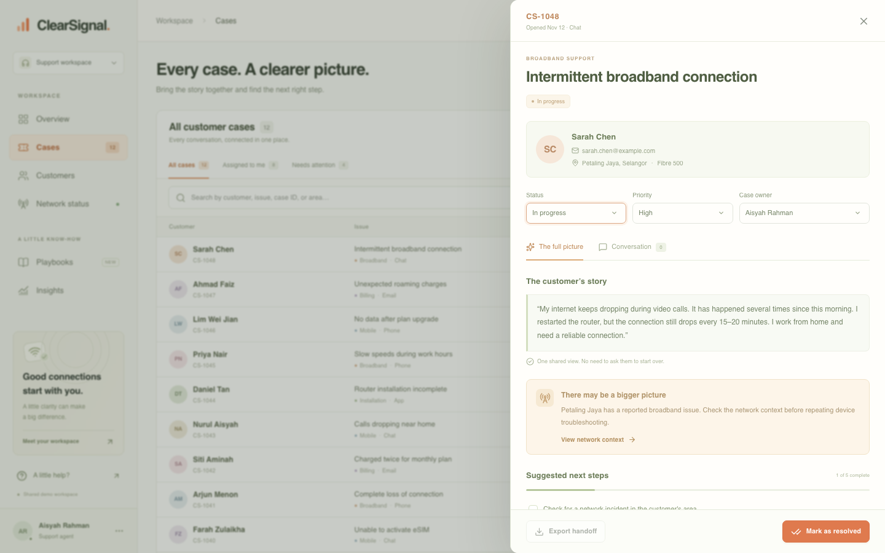
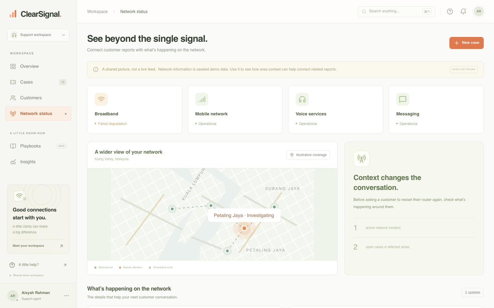
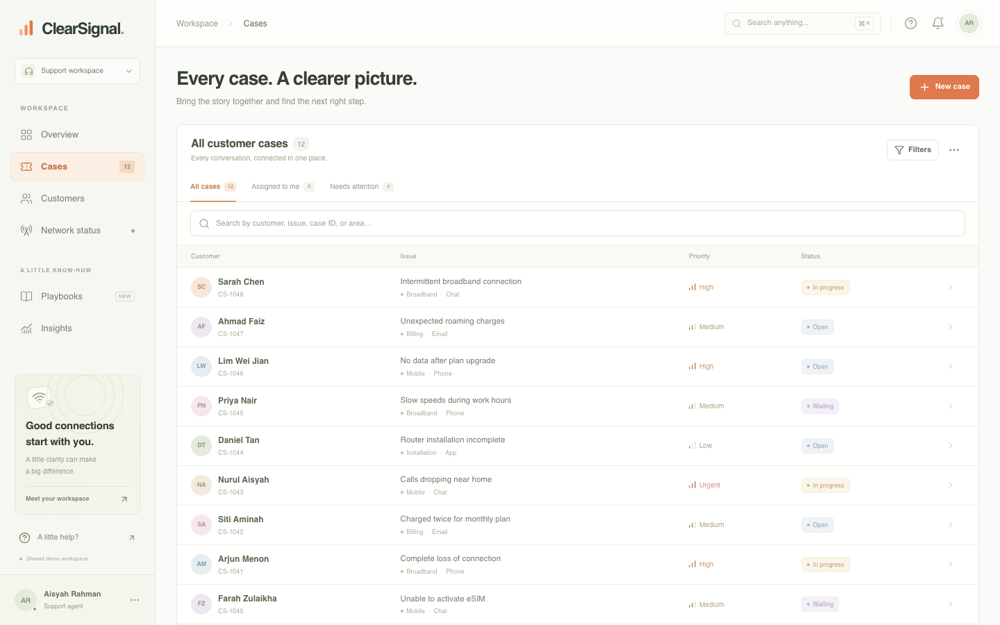
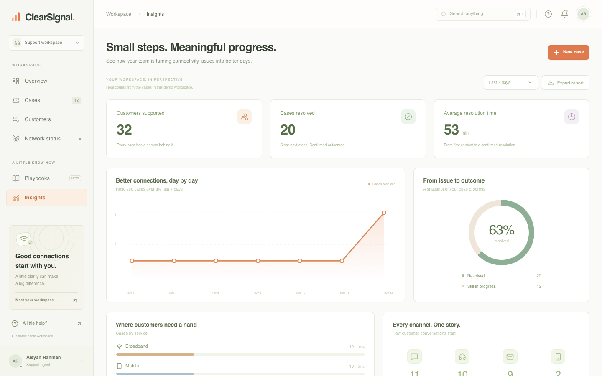
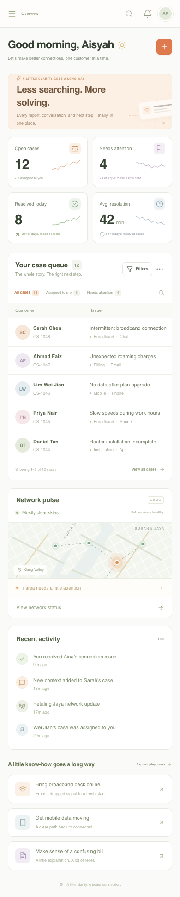

<div align="center">


# ClearSignal

**A little clarity. A better connection.**

A shared telecom support workspace that keeps every customer story, network context, and next step in one case. Seeded with a Malaysian demo dataset for the Klang Valley and beyond.

### [▶ Open ClearSignal — clear-signal-two.vercel.app](https://clear-signal-two.vercel.app)

[](https://nextjs.org)
[](https://react.dev)
[](https://www.typescriptlang.org)
[](https://tailwindcss.com)
[](https://orm.drizzle.team)
[](https://supabase.com)
[](https://playwright.dev)
[](LICENSE)



</div>

## What it is

ClearSignal is a support-agent workspace for a broadband and mobile provider. A customer's story is usually scattered across calls, chats, and internal notes — ClearSignal pulls it into **one persistent case** with the conversation history, area-level network context, troubleshooting progress, and a clear next step.

- **One customer, one case.** Every channel, note, and checklist step stays attached to the same story.
- **Network context, not guesswork.** Area-level incidents are linked to open cases so agents stop asking customers to repeat the same steps.
- **Real writes, saved progress.** Notes, owners, priorities, status, checklists, and bookmarks are stored in PostgreSQL.
- **Handoffs people can use.** Export a case, or build a customer update from a playbook — never sent automatically.

## Try the complete story

1. Open **Sarah Chen · CS-1048** from the overview.
2. Open **Conversation** to see the chat report, a phone follow-up, and the internal note together.
3. Follow **View network context** to see the **Petaling Jaya** incident and its related cases.
4. Save troubleshooting progress and add an internal note.
5. Expand **A clearer customer update** to personalise and copy a playbook-based draft.
6. Download **Export handoff**, or select **Mark as resolved** after confirming the customer's outcome.
7. Refresh the page — everything above is still there.

<div align="center">


</div>

## The workspace

| Understand | Resolve | Hand over |
| --- | --- | --- |
| Global search (`Ctrl/Cmd + K`) | Six troubleshooting playbooks | Customer update drafts |
| Case queue with filters and pagination | Saved checklist progress | Export handoff |
| Customer profiles and case history | Internal notes and conversations | CSV export |
| Area network incidents | Priority, status, and owner changes | 7-day and 30-day insights |
| Responsive mobile layout | Keyboard-accessible dialogs | Reopen resolved cases |

Extras: saved playbooks, a live activity feed, keyboard shortcuts, and server-side validation on every write.

<div align="center">


</div>

## Malaysian demo dataset

| Data | Coverage |
| --- | --- |
| Customers | 32 fictional Malaysian cases |
| Areas | Petaling Jaya, Kuala Lumpur, Subang Jaya, Bangsar, Johor Bahru, Cheras, Shah Alam, Mont Kiara, Cyberjaya, Ampang, Puchong |
| Network incidents | Petaling Jaya fibre degradation; scheduled Kuala Lumpur maintenance |
| Agents | Aisyah Rahman, Faizal Rosli, Nurul Huda |
| Currency | Malaysian Ringgit (RM) |
| Map | Illustrative Klang Valley coverage map |

<div align="center">

</div>

## Tech stack

| Layer | Choice |
| --- | --- |
| Framework | Next.js 16 (App Router, Turbopack) |
| UI | React 19, Tailwind CSS v4, lucide-react |
| Language | TypeScript 5 |
| Data | PostgreSQL 17 (Supabase) + Drizzle ORM (`pg`) |
| Testing | Playwright end-to-end |
| Hosting | Vercel |

### Connection pooling

Vercel serverless functions open many short-lived connections, so the app uses Supabase's **transaction pooler** (port `6543`) and caps each pool at three clients. The session pooler (port `5432`) hits Supabase's 15-client session limit under load — `EMAXCONNSESSION`.

## Run locally

```bash
git clone https://github.com/itsLucas02/clear-signal.git
cd clear-signal
npm install
cp .env.example .env      # set DATABASE_URL
npx drizzle-kit push --dialect postgresql --schema ./src/db/schema.ts --url "$DATABASE_URL"
npm run dev
```

Open <http://localhost:3000>. Demo data is inserted automatically on the first workspace request.

```bash
# PostgreSQL via Supabase (transaction pooler)
DATABASE_URL="postgresql://postgres.<project-ref>:<password>@<region>.pooler.supabase.com:6543/postgres"
```

## Deploy to Vercel

1. Push this repository to GitHub and import it in Vercel.
2. Add a **Postgres database** (Supabase, Neon, or any Postgres) and set `DATABASE_URL` on the project for Production and Preview.
3. Apply the schema once:
   ```bash
   DATABASE_URL="<your-postgres-url>" npx drizzle-kit push --dialect postgresql --schema ./src/db/schema.ts --url "$DATABASE_URL"
   ```
4. Deploy. No other environment variables or build settings are required.

## Project structure

```
src/
  app/                 # App Router pages, layout and route handlers
    api/               # workspace, cases, notes, playbooks, health
  components/          # shell, case table, drawer, dialogs, views
  db/                  # Drizzle client and schema
  lib/                 # seed/store, client helpers, types and playbooks
public/
  favicon.svg
  fonts/OFL.txt        # DM Sans license
tests/                 # Playwright workflow and UI regression suites
docs/                  # Screenshots used by this README
```

## Verification

```bash
npm run typecheck     # tsc --noEmit
npm run lint          # eslint
npm run build         # production build
```

End-to-end checks against a running app:

```bash
npx playwright install chromium
npm run build && npm start &
PLAYWRIGHT_BASE_URL=http://localhost:3000 npx playwright test
```

The suite covers case creation, notes, checklist persistence, reassignment, resolution, exports, bookmarks, network-to-case navigation, mobile layout, and **global select-control spacing** — a regression test that keeps every chevron clear of its container edge.

## Demo boundaries

This is an openly accessible, shared demonstration workspace, not a carrier production system. It ships with 32 fictional Malaysian cases, two illustrative network incidents, and sample customer reports. Use sample information only.

Case changes and saved playbooks are real database writes. Network information is seeded, not a live carrier feed. Customer updates are editable templates, not AI diagnoses or sent messages. The map is illustrative. No external telecom account, API key, authentication service, or billing integration is required.

## License

[MIT](LICENSE) © 2026 Aizzul Luqman

Typography uses DM Sans with a system sans-serif fallback. The DM Sans OFL license is included at [`public/fonts/OFL.txt`](public/fonts/OFL.txt).
